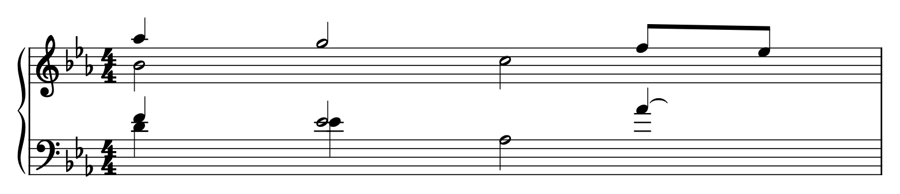
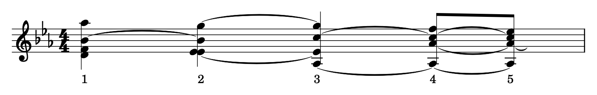
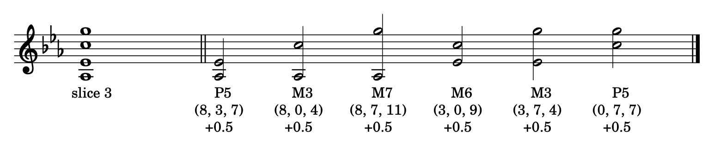

# How the tally works: one measure step by step

This page follows `analyze_intervals()` through a single measure:
WTC Book I, Prelude in E♭ major (BWV 852), measure 14. Both weights are
switched on (`durationWeight=True`, `metricWeight=True`), as in the notebook.

## 1. The measure in the score



The measure has four voices: two in the upper staff and two in the lower
staff. The voices move at different moments. For example, the B♭4 in the
upper staff is held for two beats while the A♭5 above it moves to G5 after
one beat.

## 2. The chordified measure

`score.chordify(removeRedundantPitches=False)` puts all voices together into
one series of chords ("slices"). A new slice starts whenever *any* voice
starts or ends a note:



The ties show notes that were split because another voice moved while they
were held. The B♭4 from the score now appears in slice 1 and again,
tied, in slice 2. Each piece is treated as a separate note.

In slice 2, two voices play the same E♭4. Because the code uses
`removeRedundantPitches=False`, both notes stay in the slice.

For each slice the code reads its duration (`quarterLength`) and its metric
weight (`beatStrength`). The weight of every interval in the slice is the
product of the two:

| Slice | Beat | Notes | `quarterLength` | `beatStrength` | Weight per interval |
|---|---|---|---|---|---|
| 1 | 1 | D4 F4 B♭4 A♭5 | 1 | 1 | 1 × 1 = **1** |
| 2 | 2 | E♭4 E♭4 B♭4 G5 | 1 | 0.25 | 1 × 0.25 = **0.25** |
| 3 | 3 | A♭3 E♭4 C5 G5 | 1 | 0.5 | 1 × 0.5 = **0.5** |
| 4 | 4 | A♭3 A♭4 C5 F5 | 0.5 | 0.25 | 0.5 × 0.25 = **0.125** |
| 5 | 4½ | A♭3 A♭4 C5 E♭5 | 0.5 | 0.125 | 0.5 × 0.125 = **0.0625** |

## 3. One slice taken apart

Within a slice, every pair of notes is one interval. A slice with 4 notes
gives 4 × 3 / 2 = 6 pairs. Here is slice 3 (A♭3, E♭4, C5, G5):



Under each pair:

1. the interval name, after reducing modulo 12;
2. the key under which the pair is stored: `(lower_pc, upper_pc, interval_class)`,
   with C = 0, C♯/D♭ = 1, … B = 11;
3. the amount added to the tally: the weight of the slice, 1 × 0.5 = 0.5.

For the first pair, A♭3–E♭4:

- `get_semitone_interval()` takes the MIDI numbers 56 (A♭3) and 63 (E♭4);
- interval class: (63 − 56) mod 12 = 7, a perfect fifth;
- pitch classes: 56 mod 12 = 8 (A♭) and 63 mod 12 = 3 (E♭);
- so `pair_frequencies[(8, 3, 7)] += 0.5`.

Octaves are discarded. A♭3–C5 is a tenth, but it is stored as a major third
`(8, 0, 4)`, just like A♭3–C4 would be.

The same happens in every slice. Slice 2 contains the pair E♭4–E♭4 (a true
unison, stored as `(3, 3, 0)`). Because E♭4 appears twice in slice 2, the
pairs E♭4–B♭4 and E♭4–G5 each occur twice in that slice as well.

## 4. The result for the whole measure

Five slices of six pairs give 30 additions. Pairs with the same key are
added together. This gives the measure's contribution to the tally (in the
order used by `pprint_interval_data()`):

| Interval | Pair | Key | Weight |
|---|---|---|---|
| P1 | E♭–E♭ | `(3, 3, 0)` | 0.25 |
| P1 | A♭–A♭ | `(8, 8, 0)` | 0.1875 |
| m3 | D–F | `(2, 5, 3)` | 1 |
| m3 | F–A♭ | `(5, 8, 3)` | 1 |
| m3 | C–E♭ | `(0, 3, 3)` | 0.0625 |
| M3 | E♭–G | `(3, 7, 4)` | 1 |
| M3 | A♭–C | `(8, 0, 4)` | 0.875 |
| P4 | F–B♭ | `(5, 10, 5)` | 1 |
| P4 | C–F | `(0, 5, 5)` | 0.125 |
| A4-d5 | D–A♭ | `(2, 8, 6)` | 1 |
| P5 | A♭–E♭ | `(8, 3, 7)` | 0.625 |
| P5 | C–G | `(0, 7, 7)` | 0.5 |
| P5 | E♭–B♭ | `(3, 10, 7)` | 0.5 |
| m6 | D–B♭ | `(2, 10, 8)` | 1 |
| M6 | E♭–C | `(3, 0, 9)` | 0.5 |
| M6 | A♭–F | `(8, 5, 9)` | 0.25 |
| M6 | B♭–G | `(10, 7, 9)` | 0.25 |
| m7 | B♭–A♭ | `(10, 8, 10)` | 1 |
| M7 | A♭–G | `(8, 7, 11)` | 0.5 |
| | | **Total** | **11.625** |

For example, E♭–G gets 1: 2 × 0.25 from slice 2 (E♭4 is doubled there)
plus 0.5 from slice 3.

`process_scores()` does this for every measure of all 48 files, adding to
the same dictionary. With `total_weight=1.0` it then divides every value by
the grand total, so that all values sum to 1.

You can check this table yourself:

```python
import music21 as m21
from collections import defaultdict
from temperament_functions import analyze_intervals, pprint_interval_data

score = m21.converter.parse('scores_xml/BWV_0852.xml')
tally = defaultdict(float)
analyze_intervals(score.measures(14, 14), tally)
pprint_interval_data(tally)
```

The figures on this page are made with `docs/make_tally_figures.py`
(requires MuseScore 4). Change `SCORE`, `MN` and `SLICE` there to look at
another measure.
